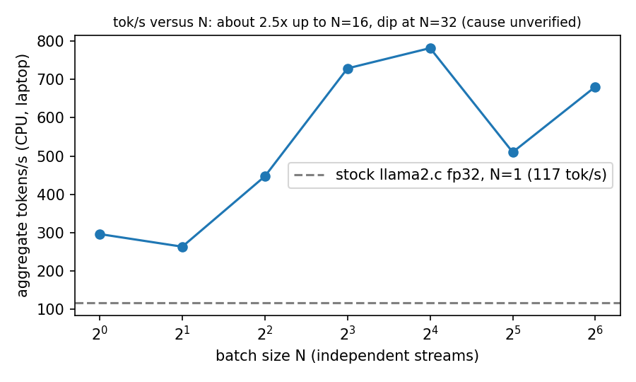
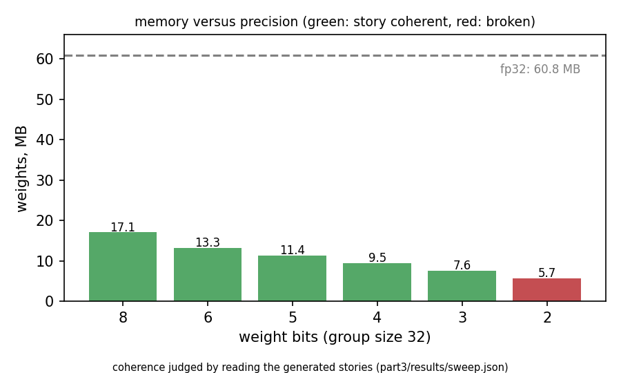

# Mini-Project 1: a GEMM kernel on the U50, and the language model that runs on it

Single bitstream, `extern "C" void gemm(A, B, C, M, K, N)`, float32, U50 (XCU50, HBM2). Everything below is a
measured number from the grader's card unless it says "estimate". Run ids refer to the submission portal; the
raw per-case logs are in `results/logs/`, the variant table is `results/logs/variants.md`, and section 12 maps every claim to its evidence.

Summary: a single fp32 GEMM bitstream for the U50 passes all nine grader cases and runs the TinyStories model at about 106 tok/s (median of eight runs of the selected design, 384 MACs at 262.3 MHz; best run 107.78; the earlier 256-MAC design reached 111.31 in its best run). Run 191 is on the leaderboard: square 6.436 ms, N=1 3.227 ms, N=32 5.281 ms, 107.78 tok/s. On the leaderboard at 22:26 on 9 October that is 4th on N=1, 5th on tok/s and 8th on N=32 and on square (the board changes as runs are starred). The N=1 path reads A at 12.5 GB/s from one HBM pseudo-channel, which probe kernels that only read show is the port's ceiling. Most of the work was diagnosis: an N=1 time stuck at 6.7 ms was traced, by reading generated RTL, to single-beat writes caused by a shared 512-bit write bundle, and fixing it halved it. On the compute side a 256-MAC array (f4) was followed by a 384-MAC K-unrolled build (k2d), which took 10% off square; a 512-MAC build (k4a) routed but clocked at 234.6 MHz and was slower (ENGINEERING_LOG.md, section 10). Parts 1 and 3 (CPU GEMM and the int8 precision sweep) are complete.

Sections 6, 7, 8, 10 and 11 are summarised below and kept in full in `ENGINEERING_LOG.md` under the same section numbers; references to those section numbers elsewhere in this report point there.

## 1. Summary

| | kernel clock | square 768^3 | N=1 total (4 shapes) | N=32 total (4 shapes) | TinyStories tok/s |
|---|---|---|---|---|---|
| v3 first working design (id 58) | 279 MHz | 32.70 ms | 8.80 ms | 24.03 ms | 57.2 |
| e2b, clock fixed, B-tile load fixed (id 114) | 288 MHz | 7.27 ms | 6.68 ms | 5.72 ms | 70.0 |
| f1, N=1 path fixed (id 138) | 279.7 MHz | 7.29 ms | 3.26 ms | 5.57 ms | 104.1 |
| f4, four identical submissions (ids 146-149), median | 281.2 MHz | 7.16 ms | 3.23 ms | 5.40 ms | 105.5 |
| f4, nine identical submissions (ids 146-149, 176-179, 181), median | 281.2 MHz | 7.15 ms | 3.25 ms | 5.41 ms | 105.4 |
| f4, run 178 (best tok/s of the nine f4 runs; the leaderboard run until k2d replaced it) | 281.2 MHz | 7.141 ms | 3.242 ms | 5.400 ms | 111.31 |
| k2d, 384 MACs (RT=6, CP=2, KUN=2), eight identical submissions (ids 184-191), median | 262.3 MHz | **6.46 ms** | **3.24 ms** | **5.28 ms** | **106.1** |
| **k2d, run 191 (the run selected for the leaderboard)** | 262.3 MHz | **6.436 ms** | **3.227 ms** | **5.281 ms** | **107.78** |
| best of each column across all our runs (not one run) | | 6.384 (k2d, run 184) | 3.225 (f4, run 148) | 5.265 (k2d, run 186) | 111.31 (f4, run 178) |
| k4a, 512 MACs, three submissions (ids 166-168), median; not selected | 234.6 MHz | 7.78 ms | 3.34 ms | 6.27 ms | 100.8 |

The nine f4 runs are the same bitstream: square 7.114-7.167, N=1 3.225-3.297, N=32 5.392-5.464, tok/s 103.7-111.3.
f4: the spread is 0.7% on square, 2.2% on N=1, 1.3% on N=32 and 7% on tok/s, so 111.31 against a median of 105.4 is run-to-run variation on identical hardware; it is the same design. Runs 146-149 were submitted first and five more (176-179, 181) on the evening of 9 October; run 178 was the leaderboard run until k2d replaced it. k2d: eight runs (184-191) span square 6.384-6.465 ms (1.3%), N=1 3.227-3.253 (0.8%), N=32 5.265-5.307 (0.8%) and tok/s 104.42-107.78 (3.2%); run 191 has the best N=1 and the best tok/s of the eight, is within 0.8% of the best square and within 0.3% of the best N=32, and was starred for that reason. The rows of runs 176-191 are in `results/evidence/portal_runs_176_181.png` and `results/evidence/portal_runs_184_191.png`. The last row of the table is a summary of extremes over all our runs, not an entry: the leaderboard takes one run per row.

Leaderboard position at 22:26 on 9 October (26 rows, run 191 live): N=1 4th (3.227 ms), tok/s 5th (107.78), N=32 8th (5.281 ms), square 8th (6.436 ms). With f4's run 178 in the row, the 21:05 board gave 4th, 4th, 10th and 11th, so k2d trades one place on tok/s for three on square and two on N=32.

The story from the accelerator run (Part 2 deliverable), run 191, 107.78 tok/s, as returned by the portal (the model writes one story, then starts another within the 256 tokens; stories differ from run to run, as the earlier runs' stories in `results/logs/runidk.md` do):

> Once upon a time, there was a boy named Timmy. Timmy was a very adventurous boy who loved to explore new places. One day, Timmy received a big box in his mail. He was very excited to open it and see what was inside.
> But when he opened the box, he saw that it was empty. Timmy was very sad and started to cry. His mom came to him and asked what was wrong. Timmy told her that he wanted to go on an adventure but didn't know how.
> His mom smiled and said, "I know it's a adventure, but we can't go until we unpack a little more and go on another adventure." Timmy understood and they went to the kitchen to think. They found a toy car that was very attractive to Timmy and they played with it together. Timmy was very happy and forgot all about the empty box.
>
> *(a new story begins:)* Once upon a time, in a small town, there was a boy named Tom. Tom loved to play outside. One day, Tom found a big rake. He thought it was very useful. He wanted to use it to clean up the mud and sticks.
> Tom went to

Status of the larger arrays: the RT=10 and RT=12 builds failed to route (`ENGINEERING_LOG.md`, section 10). The K-unrolled builds that routed: k2d (384 MACs) at 262.3 MHz, the selected design; k4a (512 MACs) at 234.6 MHz, slower than f4 on every column and not selected. b4a and k4s (512 MACs, placement variants) and sk4 (k4a plus a streaming A reader) were still building at the deadline.

### Known limitations at the deadline, and the fix in progress
1. Square (8th) and N=32 (8th): A delivery, fix in progress. The f4 array (256 MACs) was compute-bound (88% of its peak on square, 79% on the N=32 classifier). Adding MACs helped square by 10% at 384 MACs (k2d: 6.436 ms, 141 GFLOP/s, 70% of its 201 GFLOP/s array peak) and not at 512 (k4a: clock 234.6 MHz and 48% of the MACs busy on square). Our hypothesis is that the tiled path restarts its read of A for every row tile and pays the HBM latency (about 100 cycles) each time, which bites harder as tiles get shorter. It matches k4a's N=32 A rate (6.3 GB/s predicted, 6.2 measured) but over-predicts square's (9.9 against 7.3). sk4, k4a plus one persistent streaming reader for A across the row tiles of a column pass (the structure that gives the N=1 path 12 GB/s), passes the local testbench, 1,359 edge shapes, the csynth gate (295K LUT, 2,686 DSP, 871 BRAM18, main loops II=1) and RTL co-simulation (job 105124: all seven cases, no deadlock). Its hardware build (job 105123) was submitted on the evening of 9 October and will not finish before the deadline. Model prediction, not a measurement: N=32 about 4.2-4.5 ms and square about 4.8 ms at 234.6 MHz.
2. tok/s (5th) is held back by a fixed cost of about 30 us per kernel call, which a kernel that only reads A also pays (section 4); no fix is in progress. Its size relative to other entries is inferred, not measured.
3. N=1 (4th) runs at the single-channel read rate (12.5 GB/s) and is within about 1% of a read-only kernel; raising it needs more than one channel or less data (sections 4 and 11).

## 1a. The course's checkpoints, and where each is answered

Checkpoints are those on the three course pages (Part 1 section 1.5, Part 2 section 2.6, Part 3 section 3.4). Status "measured" means a number from our own run; where something could not be measured, the last column says why.

| # | checkpoint | status | answer and evidence |
|---|---|---|---|
| 1 | Part 1: float32 passes all four shapes, GFLOP/s well above the reference floor and rising with N | done | section 1b: per-shape table at N = 1, 8, 32, 64; 2.5-14x the reference at N = 1 and 13.5-27x at N = 32 while the reference stays flat at 1.6-4.4; official tester 16/16, 64/64 over N = 2..100, 847 random shapes |
| 2 | Part 1: int8 passes all four shapes, GOP/s | done | section 1b: bit-exact at N = 1, 3, 7, 8, 24, 33, 40, 64, 100; GOP/s per shape |
| 3 | Part 1: "what made it fast" note (tiling, reuse, why N > 1 helps, what limits N = 1) | done | section 1b: register-tile reuse of B and A, no K-blocking, separate gemv for N = 1, N = 1 bound by streaming A |
| 4 | Part 2: `build_slm` IDENTICAL | done | section 5: story byte-identical to stock under the reference GEMM and ours |
| 5 | Part 2: story and tok/s on the accelerator | done | section 1: selected run 191, 107.78 tok/s (median 106.1 over eight runs of the same bitstream; the previous design's best run reached 111.31); the story shown is run 191's |
| 6 | Part 2: single-stream tok/s explained (Amdahl and N = 1) | done | section 5: matmul fraction 94%, Amdahl cap about 17x; section 4: per-token budget on the card (host about 3.2 ms, streaming 4.9 ms, per-call cost 1.3-1.6 ms) |
| 7 | Part 2: tok/s versus N, crossing the CPU baseline, with the flat ceiling | CPU curve measured; card curve modelled from measured N = 1 and N = 32 rows | section 5: measured CPU curve (296 at N = 1 rising to 782, flat near 700-800) and a modelled card curve (107 at N = 1, below the stock CPU's 118, crossing it by N = 2, rising to a flat 280 tok/s from N = 32; ceiling set by host work per stream, 305 tok/s). A hardware curve cannot be measured through the portal: the grader's host runs the story at N = 1 only. The card's measured N = 1 and N = 32 kernel totals (3.2 and 5.4 ms) show the batching payoff, about 19x lower cost per vector |
| 8 | Part 2: which matmuls are accelerated and the step from each | CPU ladder measured; card per-group budget; no hardware ladder | section 5 ladder (none 118, classifier 166, + w1/w3 172, + w2 248, + attention 288 tok/s); section 4: per-group time on the card per token; the grader's host offloads all 43 matmuls, so a hardware ladder cannot be run |
| 9 | Part 2: the throughput ceiling and what raises it | done | section 4: three-part budget, harness floor about 208 tok/s, levers named (bandwidth, bytes, on-chip weights, fewer calls) |
| 10 | Part 3: `runq` int8 story and its tok/s | done | section 9: stock fp32 117, golden `runq` 307, ours 323 tok/s (medians of 5) |
| 11 | Part 3: `student_gemm_int8` matches the golden inside the model | done | section 9: greedy output byte-identical on two prompts, sampled output identical on 10 of 10 seeds |
| 12 | Part 3: three-axis table, including where the story breaks | done; tok/s measured for fp32 and int8, modelled for other widths | section 9: story breaks between 3 and 2 bits at group sizes 32 and 8 (group size 64 does not exist for dimension 288); memory exact from the format; tok/s for other widths is a model fitted to the two measured points and labelled as such |
| 13 | Part 3: the shipped operating point, defended | done | section 9: int8, group size 32, with the three curves |

## 1b. Part 1: the CPU GEMM (float32 and int8)

`part1_cpu/student_gemm.c` and `part1_cpu/student_gemm_int8.c`: single core, AVX2 selected at run time, built by the official harness with plain `gcc -O3 -lm` (no `-march`, no OpenMP). Laptop (i7-1260P); timings drift about 2x between identical short runs, so ratios inside one run are the reliable quantity. Full tables and method: `BENCHMARKS.md`.

float32, GFLOP/s, best of 7 (the reference column is the course's naive kernel, which stays flat in N):

| shape (M x K) | N=1 | N=8 | N=32 | N=64 | reference N=1 / N=32 | ours / reference at N=1, N=32 |
|---|---|---|---|---|---|---|
| attn-proj 288x288 | 11.1 | 70.6 | 59.0 | 96.4 | 2.47 / 4.38 | 4.5x, 13.5x |
| ffn-up 768x288 | 20.7 | 63.8 | 98.1 | 110.8 | 3.18 / 3.69 | 6.5x, 26.6x |
| ffn-down 288x768 | 22.9 | 82.5 | 88.1 | 97.2 | 1.63 / 3.30 | 14.0x, 26.7x |
| classifier 32000x288 | 10.6 | 49.9 | 81.8 | 96.3 | 4.17 / 3.78 | 2.5x, 21.6x |

int8 (GS=32), GOP/s, best of 5:

| shape (M x K) | N=1 | N=8 | N=32 | N=64 | reference N=1 / N=32 | ours / reference at N=1, N=32 |
|---|---|---|---|---|---|---|
| attn-proj | 9.8 | 21.3 | 38.9 | 43.0 | 1.82 / 2.44 | 5.4x, 15.9x |
| ffn-up | 24.6 | 26.6 | 44.9 | 47.4 | 2.15 / 1.59 | 11.4x, 28.2x |
| ffn-down | 22.0 | 31.1 | 47.4 | 48.1 | 2.40 / 2.52 | 9.2x, 18.8x |
| classifier | 19.3 | 29.6 | 47.9 | 44.8 | 1.86 / 2.77 | 10.4x, 17.3x |

- Correctness: the official cases 16/16, plus 64/64 over N from 2 to 100, plus 847 random shapes including odd M, K, N against a double-precision reference (worst absolute error 7e-5, tolerance 1e-2). int8 is bit-exact against the reference (relative tolerance 1e-4, which forces the reference operation order `(As*Bs)*dot`) at N = 1, 3, 7, 8, 24, 33, 40, 64, 100.
- Against OpenBLAS 0.3.28, one thread each, N=1 vs `cblas_sgemv` and N>1 vs `cblas_sgemm` (median of 3 runs): 0.97-1.27x at N=1, 1.2-1.8x at N=8, 1.13-1.22x at N=32, 1.06-1.12x at N=64. That is a shape-specialised kernel against a general library on four fixed shapes and N <= 64 only; I would call 1.0-1.1x "about equal".
- Two earlier claims were retracted: a 2.5-3.7x win at N=1 compared against `sgemm` on a vector (an unfair baseline), and a 1.18x classifier win at N=32 that was a 16-thread run.

### What made it fast (the course's "what made it fast" note)

Four decisions, in order of effect.

1. Reuse comes from the register tile, and N is what pays for it (N > 1). For N <= 64 the kernel packs B once per call into K x 16 panels (K x 8 for N <= 8; the last panel zero-padded) and computes C in 6 x 16 register tiles: 12 accumulators (6 rows x two 8-float vectors), two B vectors and one broadcast of A, which is 15 of the 16 AVX2 registers. Per k-step that is 6 broadcasts and 2 B loads feeding 12 FMAs, so each loaded B vector is used 6 times and each broadcast A element 16 times. For N <= 8 the tile is 12 x 8 (a 16-wide strip would waste half its lanes). The weight matrix A is read from memory once whatever N is, so the flops per byte of A are 2N/4: 0.5 at N = 1, 16 at N = 32. So throughput climbs with N, and the reference stays flat at 2-4 GFLOP/s.
2. No K-blocking and no packing of A. K is only 288 or 768, so the six A rows of a tile (6.9 KB at K = 288, 18 KB at K = 768) sit in L1 across all panels of B, and the B panels (up to 73 KB for K = 288, N = 64) stay in L2. A is a weight matrix read once per call, so repacking it would cost a pass for nothing. Only the general path (N > 64, not a graded shape) uses the BLIS-style packed loops (MC/KC/NC = 120/256/512).
3. N = 1 is a different kernel (gemv). There is no reuse to exploit, so the kernel only tries to keep memory busy: 8 rows per pass, one 8-float load of B feeding 8 FMAs into 8 independent accumulators (enough chains to cover the FMA latency), a horizontal sum per row at the end, and 32-wide unrolled dot products for the ragged tail.
4. Runtime dispatch, single core. AVX2 + FMA is chosen at run time (`__builtin_cpu_supports`) with `target` attributes, because the official build is plain `gcc -O3` with no `-march`; scalar fallback otherwise. The OpenMP pragmas are commented out on purpose: the harness is single-core.

### What limited N = 1

0.5 flop per byte of A, so the kernel is bound by how fast A streams. The classifier (A = 36.9 MB, from DRAM) reaches 10.6 GFLOP/s, which is 21 GB/s of A; I did not measure this laptop's single-core DRAM bandwidth, so I do not claim that is its ceiling. The 288 x 288 call is about 15 us in total, so fixed costs (call, dispatch, cold caches) are a visible share of it, and I did not separate them. The two mid-size shapes (A of 0.9 MB) are the fastest at N = 1, 21-23 GFLOP/s.

### int8 (`part1_cpu/student_gemm_int8.c`)

The reference rounds as `acc += (As * Bs) * (float)dot`, with groups added in ascending order, and the tester compares per element at 1e-4 relative. To be bit-exact the kernel keeps exactly that order and is compiled with `target("avx2")` only, so the compiler cannot contract it into FMAs. Inside a group the dot product is exact integer arithmetic: bytes widened to int16 and `madd_epi16` into int32 (gemv: 16 k-values per step; gemm: two adjacent k-rows of B are interleaved with `unpack`, then multiplied by a broadcast pair of A values, 16 columns per pass). The float scale is applied once per group. The result: 9.8-48.1 GOP/s, 5-11x the reference at N = 1 and 16-28x at N = 32, but at N >= 8 below the float kernel's GFLOP/s (21-48 against 50-111), because the per-group float conversion and the widening cost more compute than the byte savings buy back; at N = 1 the two are comparable (int8 is ahead on ffn-up and the classifier, 24.6 against 20.7 and 19.3 against 10.6). The int8 gain is in bytes (4x less weight traffic), which shows up at N = 1 in the model (section 9: 2.7x tok/s on the CPU) and not as peak throughput. I did not use AVX-VNNI even though this laptop has it, so the kernel stays within what the grader's CPU is likely to have.

## 2. Roofline

Two bounds apply, one for each kind of case.

N=1 is bandwidth-bound. A matrix-vector product reads every weight once and does 2 flop with it: 0.5 flop/byte. The
four N=1 shapes read 38,965,248 B of A in total, 36.9 MB of it in the 32000x288 case.
- The datasheet (AMD DS965) gives 316 GB/s for the whole card, as a measured peak, with a 201 GB/s nominal figure; HBM power is limited, so it varies between designs. Spread over 32 pseudo-channels that is an average of 9.9 GB/s, below what we measured on one channel, so it is a card-level figure and not a per-channel cap. I do not have a vendor per-channel peak, so I quote no percentage of peak. One 512-bit kernel port at 300 MHz would be 19.2 GB/s.
- Measured on the 32000x288 case: 2.944-2.981 ms, i.e. 12.4-12.5 GB/s from one pseudo-channel. Probe kernels that only read A reach the same 12.5 GB/s with different banks and outstanding counts, so this is what this port delivers. The whole N=1 sum (38.97 MB in 3.26 ms) is 11.95 GB/s.
- A probe kernel that only reads A (no multiply, XOR checksum) took 2.948 ms; the real gemv took 2.952-2.981 ms. The gemv is within 1% of the best this port can do.

Square 768^3 and N=32 are compute-bound for our 256-MAC array; A delivery is the next limit. 906 MFLOP for the square case.
- The f4 array is 256 MACs (8 rows x 32 columns), one fp32 MAC per lane per cycle: 256 x 2 x 281 MHz = 144 GFLOP/s peak.
- Measured: 906 MFLOP / 7.16 ms = 126.5 GFLOP/s, 88% of the array's peak (f1: 124.3 GFLOP/s, 87%). On the 32000x288x32 case, 113.8 GFLOP/s, 79%.
- k2d (384 MACs: 6 rows x 32 columns split over two compute processes, KUN=2) at 262.3 MHz: peak 384 x 2 x 262.3 MHz = 201 GFLOP/s. Measured on the selected run: 906 MFLOP / 6.436 ms = 140.8 GFLOP/s, 70% of that peak. Its A demand is 384 / 32 = 12 floats per cycle, 12.6 GB/s at 262.3 MHz, right at the 12.5 GB/s one channel delivers, so it sits at the wall described next.
- A second roof applies once the array grows: with 32 columns per tile each loaded element of A serves 32 columns, so an array of M MACs needs M/32 floats of A per cycle (8 for our 256 MACs, 9 GB/s at 281 MHz; 16 for a 512-MAC array, 15 GB/s at 234.6 MHz) against 12.5 GB/s from one channel. For this tiling that caps square at 12.5 GB/s x 16 flop/byte = 200 GFLOP/s whatever the MAC count; we are at 63% of it. The 512-MAC build (k4a, section 10) is the evidence that this roof, not the MAC count, is what binds next.
- Against the device: with the default float core (5 DSP per MAC: 3 for the multiply, 2 for the add) about 1,190 MACs fit in 5,952 DSPs, a roof of about 710 GFLOP/s at 300 MHz. We use 17-18% of that. The array is well utilised, but it is a small array; more MACs per LUT and per DSP, and use of both SLRs, is probably what the faster entries did (an inference from their numbers, not something I could check).

## 3. How N=1 went from 6.7 ms to 3.26 ms

The N=1 sum was stuck at 6.7 ms across three redesigns while square and N=32 improved 35%. The earlier explanation ("A reads cap at about 6-7 GB/s") was wrong. What found the cause:

1. **Isolated probes.** The portal times every row of a run even when the run is rejected for wrong results (id 76 showed it). So N=1-only kernels, which fail the N>1 rows by design, still report N=1 times. Four small builds (86 DSP, 17K LUT instead of 769 DSP, 157K LUT):
   la (streaming gemv) 2.981 ms; le (A, B, C on different HBM banks) 2.952; lb (64 outstanding reads instead of 16) 2.950; pa (pure reader) 2.948. HBM bank placement, outstanding count and the FIFO chain make no difference. The read path was never the limit.
2. **The full design, same gemv code, was 6.35 ms.** The generated RTL of the full design shows the C write loop issuing `AWLEN = 1` single-beat writes, one per output row, and the csynth log has no write-burst line for it; the lite kernel's log does. Cause: the tiled path stores C 16 floats at a time, which widens the whole `gmem2` bundle to 512 bits, so the gemv's 32-bit C writes became strobed single-beat writes. The extra 3.4 ms over the lite kernel across 32,000 rows is about 106 ns, roughly 30 cycles per write (inferred from the time difference, not measured per write).
3. **The fix** is a 23-line change: write C in whole 512-bit words, scalar tail for partial tiles. csynth then reports "burst writes of length 4 and bit width 512"; area is unchanged. RTL co-simulation passes on all seven test cases. On the card (f1): N=1 3.26 ms, equal to the lite kernel; tok/s 77 -> 104.

## 4. What limits tok/s: the per-token budget

A token is 43 matrix-vector products (24 of 288x288, 12 of 768x288, 6 of 288x768, one 32000x288) and moves 60.8 MB of fp32 weights.
From the f1 per-case rows (0.063 / 0.106 / 0.111 / 2.979 ms) the matmuls take 24 x 0.063 + 12 x 0.106 + 6 x 0.111 + 2.979 = 6.43 ms.
The token takes 1000 / 104.08 = 9.61 ms, so the rest is about 3.2 ms of host work. The same arithmetic on older runs gives 3.2 ms
(v5bcf) and 2.8 ms (v3), so it is a property of the host, not of one design.

| part of one token | time | share |
|---|---|---|
| host work between matmuls (norms, attention, sampling, launches) | ~3.2 ms | 33% |
| streaming 60.8 MB of weights at 12.5 GB/s | 4.86 ms | 51% |
| fixed cost of 43 kernel calls (about 36-40 us each on f1, about 30 us on f4: launch plus pipeline fill) | ~1.6 ms | 16% |

Where the card's matmul time goes per token (f4, run 149 per-case rows: 0.056 / 0.097 / 0.102 / 2.982 ms for the four shapes at N = 1). Weighting by the 24 / 12 / 6 / 1 calls per token: the 24 attention projections (288x288) take 1.34 ms (22% of the 6.10 ms of matmul), the 12 w1/w3 products (768x288) 1.16 ms (19%), the 6 w2 products (288x768) 0.61 ms (10%) and the classifier 2.98 ms (49%). The token takes 1000 / 106.61 = 9.38 ms, so the rest is 3.28 ms of host work. The classifier is 49% of the card's matmul time against 65% of the CPU's (laptop profile), because the 42 small calls pay the per-call cost 42 times: they take 3.12 ms, of which about 1.3 ms (42 x 30 us) is that fixed cost. The grader's host offloads all 43 matmuls, so the step from offloading each group on its own cannot be measured on the card; the CPU backend ladder in section 5 is the per-group evidence. These per-token numbers are f4's; the selected k2d design uses the same N=1 path and its N=1 sum is 3.227 ms against f4's 3.237, so the budget is essentially unchanged.

The three terms add to 9.7 ms against 9.6 ms measured. That is the throughput ceiling. What would raise it:
more bandwidth than one pseudo-channel gives, fewer bytes per token (int8 would cut the 4.86 ms to about 1.2 ms), weights resident on chip
(int8 weights are about 15 MB, which fits in the U50's roughly 28 MB of URAM and BRAM), fusing calls to cut the per-call cost, or overlapping the host work. We did not build any of these.

The per-call cost is a floor, and it explains why tok/s does not follow the N=1 column. The pure-reader probe (pa, run 125), which only reads A and writes a checksum, takes 0.057 ms on 288x288 where the data takes 0.027 ms at 12.5 GB/s; the full f4 design takes 0.056 ms. So about 30 us per call is the cost of a kernel on this harness whatever it computes. A token makes 43 calls, so that is about 1.3 ms of the 9.4 ms, while the N=1 column (each shape once) sees it four times. So rows with nearly equal N=1 sums can differ in tok/s: 3.200 ms gives 114.66 and our 3.237 ms gives 106.61. Solving the two sums (N=1 sum = 38.97 MB / r + 4f, matmul per token = 60.8 MB / r + 43f, with the 3.2 ms host time assumed equal for every row) puts r near 12.5 GB/s for every row, and f at 6-14 us for the faster rows against our 31 us. That is derived from the public rows under an assumed host time, not measured, and I do not know what they do differently. Not tested: whether any of our 30 us lies below the kernel (a kernel with no memory access, timed on the portal, would show it).

## 5. Part 2 questions (CPU-side measurements, laptop, plain `gcc -O3`)

- Seam check (`build_slm` IDENTICAL): with the course's `slm_backend` routing `matmul` to `student_gemm` (N=1), the generated story is byte-identical to stock llama2.c under both the reference GEMM and ours (same prompt, seed, `-t 0`; `notes.md`, "Oct 5: Part 2 seam"). CPU tok/s over 5 runs on this laptop: reference GEMM 59-88, ours 181-253 (stock `run`: about 106, single run). The accelerator run is section 1 (runs 138, 146-149, 176-191).
- Matmul fraction f: 91.8-95.7% of runtime (mean ~94%); the Amdahl cap for accelerating only the GEMMs is about 17x (12-23x).
- Which shape dominates: the 288->32000 classifier, 64.9% of matmul time, not the FFN (w1/w3 15.3%, attention 10.3%, w2 9.5%). On the card (f4) the classifier is 2.98 of 6.10 ms of matmul per token (49%).
- tok/s versus N (CPU, aggregate tokens/s, median of 5): N=1 296, N=2 263, N=4 447, N=8 729, N=16 782, N=32 510, N=64 681. It rises about 2.5x and flattens near 700-800 where non-GEMM work (attention per stream, sampling, gather) dominates. The N=32 dip is an unverified hypothesis (per-stream KV caches falling out of cache).

- On the card: the grader's host runs the story at N = 1 only, so a hardware tok/s-versus-N run cannot be made with a bitstream alone (it needs a host that carries N > 1 streams, which is the open host-bundle question in `ENGINEERING_LOG.md` section 11). What we measured on the card is the kernel at both ends: the N = 1 total is 3.2 ms and the N = 32 total is 5.4 ms, so 32 times the work costs 1.7 times the time and the cost per vector falls about 19x. That is the batching payoff.
- tok/s versus N on the card, modelled from those measured rows (f4 design; k2d has the same N=1 path and a slightly faster N=32 total). A decoding step with N streams costs the per-stream host work (3.28 ms per token, from run 149: 9.38 ms per token minus 6.10 ms of N = 1 matmul) plus one pass of the 43 matmuls. The matmul pass is measured at N = 1 (6.10 ms) and at N = 32 (24 x 0.074 + 12 x 0.146 + 6 x 0.139 + 5.033 = 9.39 ms, run 149). For 2 <= N <= 32 the tiled kernel pads to a 32-column tile, so I take the pass as 9.39 ms; above 32 it reads the weights again per 32-column tile, so 9.39 ms per 32 columns. Then aggregate tok/s = 1000 / (3.28 + pass / N):

| N | 1 | 2 | 4 | 8 | 16 | 32 | 64 | 128 |
|---|---|---|---|---|---|---|---|---|
| modelled card tok/s | 107 (measured: 106.6) | 125 | 178 | 225 | 259 | 280 | 280 | 280 |
| CPU baseline (stock run, one stream) | 118 | | | | | | | |

The curve starts below the CPU baseline at N = 1, as the course page warns, crosses it between N = 1 and N = 2, rises about 2.6x and then goes flat at about 280 tok/s from N = 32: beyond that the kernel time grows in proportion to N, and the host work per stream (3.28 ms, ceiling 305 tok/s) is the limit; the weights are not. This is a model, not a measurement. It assumes the host work per token does not change with N (batching on the host would raise the ceiling), that N between 2 and 31 costs what N = 32 costs on the card (follows from the padded tile, not measured), and that the grader's host has the 3.28 ms we infer. The CPU curve above is measured.
- Offload order (CPU backend, tok/s median of 7): none 118, classifier only 166, plus w1/w3 172, plus w2 248, plus attention 288. The classifier alone is the biggest step.

## 6. Clock, and what we could not fix (full text: `ENGINEERING_LOG.md`)

The kernel closes at 279-288 MHz against a 300 MHz target. The clock rose from 187 to 283 MHz when an accumulator reset net with about 65,000 sinks was removed and the compute was split into processes; the remaining limit is the pipeline-valid enable net into the accumulators (routed WNS -0.24 ns, 89-92% of the delay in routing). Two attempts did not help and are recorded so they are not repeated: a Vivado post-route physical-optimization pass (+0.5%) and `style = frp`, which HLS never applied to the loop.

## 7. Debugging: the loops, the method, and the wrong turns (full text: `ENGINEERING_LOG.md`)

Every problem was worked the same way: turn the symptom into a number, build the cheapest experiment that separates two explanations, read the artifact itself (routed timing report, generated Verilog, csynth log, per-case table), and write down what was wrong, including my own earlier conclusions. The log tabulates seven problems: a dataflow design rejected for wrong results (id 76), the 187 MHz clock, a doubled DSP count, a slow B-tile load, N=1 stuck at 6.7 ms (section 3), a no-effect physical-optimization pass, and builds that failed under `/tmp`. Explanations I withdrew: "N=1 is limited at 6.9 GB/s" (it was cycles per word for one build and the write path for another), "frp did not help" (it was never applied), a tok/s formula fitted on other entries, and "+2% is noise" for f4 (repeat runs showed it was real).

## 8. Reproduce (full text: `REPRODUCE.md`)

Source for every variant is in `fpga/variants.zip` (flags and job ids in `results/logs/variants.md`); the selected design is `fpga/k2d/` and the 256-MAC baseline is `fpga/f4/`. Build, submit and local-gate commands are in `REPRODUCE.md`.

## 9. Part 3: int8, and where the story breaks

`part3_int8/int8_backend.c` routes `runq`'s matmul through our `student_gemm_int8` (A = the weight tensor with M = d, K = n; B = the quantized activation vector, N = 1; scale layouts match the contract). Greedy output is byte-identical to the golden `runq` on two prompts, and sampled output (t = 0.8, top-p 0.9, 200 tokens) is identical on 10 of 10 seeds.
Speed on the laptop (greedy, 256 tokens, 5 runs): stock fp32 `run` 115-119 tok/s, golden `runq` 256-324, ours 299-323. Medians 117 / 307 / 323, so int8 is about 2.7x faster than fp32 on the CPU and our kernel keeps up with the golden.

**Group size 64 does not exist for this model.** The model dimension is 288, not a multiple of 64, so the exporter falls back to 32 (its "GS=64" file is the same size as the GS=32 file). The sweep therefore uses group sizes 32, 16 and 8.

**The sweep.** `runq` only does int8, so lower widths are requantized to b bits (range +-(2^(b-1)-1), per-group scale) and stored in the same container. Story quality is exactly that of b-bit weights; memory is computed from the format (b/8 + 4/GS bytes per weight); tok/s is measured only for int8 (sub-8-bit would need a packed kernel, not built). Quantized tensors total 15.19M weights; the classifier (shared with the token table) is 9.22M. fp32 baseline: 60.8 MB of weights, 36.9 MB for the classifier. Greedy decoding, `part3_int8/sweep.py`, raw results in `part3_int8/results/sweep.json`.

| precision | classifier | all weights | story (prompt "Once upon a time", greedy) |
|---|---|---|---|
| fp32 | 36.9 MB | 60.8 MB | "...a big, red ball in the sky. It was the sun! She thought it was so pretty." |
| int8, GS 32 | 10.4 MB | 17.1 MB | same words as fp32 for the first 230 characters |
| int8, GS 16 / 8 | 11.5 / 13.8 MB | 19.0 / 22.8 MB | same (GS 8 diverges a little later) |
| 6-bit, GS 32 | 8.1 MB | 13.3 MB | coherent, different story ("a big, dark cloud ... going to rain") |
| 5-bit, GS 32 | 6.9 MB | 11.4 MB | coherent, different story (park, swings, a scary dog) |
| 4-bit, GS 32 / 16 / 8 | 5.8 / 6.9 / 9.2 MB | 9.5 / 11.4 / 15.2 MB | coherent in all three, different story each time |
| 3-bit, GS 32 / 8 | 4.6 / 8.1 MB | 7.6 / 13.3 MB | still coherent English (a boy named Timmy / a red apple on a tree) |
| **2-bit, GS 32 / 8** | 3.5 / 6.9 MB | 5.7 / 11.4 MB | **breaks**: "Once upon a time firsthingheshesheshesherunchunchunchunch..." and "away always always for, read read read read..." |

The edge is between 3 and 2 bits, at both group sizes. The exact-match measure (share of the fp32 story reproduced before the first divergence, mean over 5 prompts) is harsh and not monotonic: int8 GS 32 keeps 38%, GS 16 48%, 6-bit 13.5%, 4-bit 5-8%, 3-bit 3-5%, 2-bit 2.5%. Greedy decoding diverges at the first near-tie in the logits, so even int8 does not reproduce the whole fp32 story; coherence, not identity, is the practical test. Limits: one model, 5 prompts, one seed per prompt, activations stay int8, and "coherent" is my reading of the text, not a metric.

**tok/s versus precision.** Measured on the CPU (greedy, 256 tokens, medians of 5): fp32 117 tok/s and int8 GS 32 307 tok/s. The other widths cannot be run without a packed kernel, which we did not build, so their tok/s comes from a model fitted to those two measurements: at N = 1 a token costs t = h + B / b, with B the weight bytes. Fitting the two points gives an effective weight bandwidth b = 8.3 GB/s and h = 1.19 ms of everything else; the fp32 and int8 rows therefore agree with the measurements by construction, and the others are predictions of the model, not measurements. For widths below 8 bits they are upper bounds, because unpacking costs compute that the model ignores.

| precision | weights | N = 1 tok/s on the CPU | source |
|---|---|---|---|
| fp32 | 60.8 MB | 117 | measured |
| int8, GS 32 | 17.1 MB | 307 | measured |
| int8, GS 16 | 19.0 MB | 287 | model |
| int8, GS 8 | 22.8 MB | 253 | model |
| 6-bit, GS 32 | 13.3 MB | 357 | model, upper bound |
| 5-bit, GS 32 | 11.4 MB | 390 | model, upper bound |
| 4-bit, GS 32 | 9.5 MB | 428 | model, upper bound |
| 3-bit, GS 32 | 7.6 MB | 475 | model, upper bound |
| 2-bit, GS 32 | 5.7 MB | 533 | model, upper bound (the story is broken at this width) |

The memory axis is exact and the story axis is read from the generated text, so only this tok/s column is modelled. The int8 kernel raises the roof as the course page asks: 3.6x fewer weight bytes gave 2.6x the tok/s for the golden (117 to 307; 2.8x for our kernel, 323), short of 3.6x because the 1.19 ms of non-weight work does not shrink.

The int8, 4-bit and 2-bit stories next to the fp32 story (first 330 characters, same prompt, greedy; `results/figures/stories_excerpt.txt`):

> **fp32:** Once upon a time, there was a little girl named Lily. She loved to play outside in the sunshine. One day, she saw a big, red ball in the sky. It was the sun! She thought it was so pretty. Lily wanted to play with the ball, but it was too high up in the sky. She tried to jump and reach it, but she couldn't. Then, she had an idea.
>
> **int8 (GS 32):** Once upon a time, there was a little girl named Lily. She loved to play outside in the sunshine. One day, she saw a big, red ball in the sky. It was the sun! She thought it was so pretty. Lily wanted to play with the ball, but it was too high up in the sky. She tried to jump, but she couldn't reach it. Then, she saw a big, stron...
>
> **4-bit (GS 32):** Once upon a time, there was a little girl named Lily. She loved to play outside and explore the world around her. One day, she found a big rock in her backyard. It was a very big rock and Lily was very excited to play with it. But as she was playing with the rock, she accidentally dropped it and it fell to the ground. Lily was v...
>
> **2-bit (GS 32):** Once upon a time firsthingheshesheshesherunchunchunchunchunchunchunchunchunchunchunchunchunchunchunchatingating and and and and and and and and and to It stay stay stay reallyococries whole?" it out stay stay stay stay stay stay stay stay stay stay stay stay...

The int8 story tracks fp32 for the first 250 characters and then diverges at the first near-tie (see the exact-match measure above); the 4-bit story is a different but coherent story; the 2-bit output is not English. The green and red in the figure are my reading of these texts, not a computed measure.

**Trade-off I would ship.** int8 with GS 32: 3.6x fewer weight bytes (17.1 MB against 60.8 MB), the story matches fp32 for the part we compared, and the golden-matching kernel runs 2.7x faster on the CPU. 4-bit saves another 1.8x of memory but gives a different story every time, which I would accept only if memory were the binding constraint. On the FPGA, int8 would move the weight-streaming term of section 4 from 4.86 ms to about 1.4 ms per token; with the host time (3.2 ms) and per-call cost (1.6 ms) unchanged that is about 6.2 ms per token, roughly 160 tok/s (estimate; no int8 FPGA kernel was built, and 4-bit would give about 178).

## 10. Next architecture: K-unrolled accumulation, and why the bigger arrays failed (full text: `ENGINEERING_LOG.md`)

The RT=10 and RT=12 arrays failed to route ("global congestion level 7"): the placer kept the whole kernel in SLR1 (70-81% LUT) with SLR0 nearly empty. A LUT-cost fit over five csynth points (LUT ~ 86K + 28K x compute processes + 0.29K x MACs) led to a K-unrolled kernel. Its first build, k4a (512 MACs, 292K LUT), routed and passed all nine cases on the card but clocked at 234.6 MHz and was slower than f4: square 7.78 ms, N=1 3.34 ms, N=32 6.27 ms, 100.8 tok/s (medians of runs 166-168; selected run stays f4). The worst paths were the B-tile memories (256 LUTRAM banks), and only 48% of the MACs were busy on square; my pre-run prediction of 1.4-1.6x on square is retracted. The hypothesis, not yet tested, is that the tiled path restarts its read of A for every row tile and pays the HBM latency each time (it reproduces k4a's N=32 A rate, 6.3 predicted against 6.2 GB/s measured, and over-predicts square's). k2d (384 MACs, RT=6, KUN=2) routed at 262.3 MHz in a 5 h 51 min build and is the selected design (square 6.436 ms, N=1 3.227, N=32 5.281, 107.78 tok/s in run 191). Still running at the deadline: b4a and k4s (512 MACs, placement variants) and sk4's hardware build (k4a plus a persistent streaming A reader; gated, cosim passed).

## 11. Next steps, continuing past the 9 October deadline (full text: `ENGINEERING_LOG.md`)

Plans, with no results yet. Step 0: f4 stays the base until a design beats it on the card. Step 1: an on-chip weight cache under the fp32 contract; fp16 weights pass the 1e-2 gate (worst error 0.003-0.008) and int8 and bf16 do not, and the estimate is 165-185 tok/s against the harness floor of about 208. Step 2: with a host we control, int8 weights for the whole model on chip and multi-bank HBM streaming (arithmetic estimates only; needs the host-bundle flow). Step 3: power readings and CPU/GPU baselines.

## 12. Evidence index

Every number above comes from one of these. "Run id" is the grader portal's submission id. Files marked `results/evidence/` are archives of the build logs, reports and RTL for the runs they name; variant source is in `fpga/variants.zip` (one folder per variant, flags in `results/logs/variants.md`).

| claim | where it comes from |
|---|---|
| v3: square 32.70 / N=1 8.80 / N=32 24.03 ms / 57.2 tok/s | run 58; per-case rows in `results/logs/runidk.md` |
| e2b 7.27 / 6.68 / 5.72 / 70.0; e2c 7.27 / 6.71 / 5.59 / 64.9 | runs 114 and 116; `results/evidence/harvest_e2b.zip`, `results/evidence/harvest_e2c.zip` |
| a rejected run is still timed on every row | run 76 (FAIL on 32000x288x32 only; all nine rows timed), recorded in `results/logs/variants.md` |
| N=1 probes: la 2.981, le 2.952, lb 2.950, pa 2.948 / 2.944 ms on 32000x288 | runs 122, 123, 126, 125; sources are the `fpga_la`, `fpga_le`, `fpga_lb`, `fpga_pa` folders in `fpga/variants.zip`; summary in `results/logs/variants.md` ("N=1 probe results") |
| the full design's C writes are single-beat (`AWLEN = 1`, 512-bit `gmem2`), no write-burst line in its csynth log | generated RTL in `results/evidence/rtl_e2_gv.tgz`; csynth log in `results/evidence/keep_e.zip` (`e2_csyn.log`) |
| f1: 7.29 / 3.26 / 5.57 ms / 104.1 tok/s at 279.7 MHz; the N=1 fix | run 138; routed timing and build log in `results/evidence/harvest_f1.zip` |
| f4: nine runs, medians 7.149 / 3.246 / 5.406 ms / 105.4 tok/s, 281.2 MHz; best-tok/s run 178: 7.141 / 3.242 / 5.400 / 111.31 (the leaderboard run until k2d replaced it) | runs 146-149 (`results/evidence/portal_runs.zip`), runs 176-179 and 181 (`results/evidence/portal_runs_176_181.png`, summary rows only); `results/evidence/harvest_f4.zip` (build log, clock line, routed timing report) |
| k2d: 262.3 MHz (hbm_aclk 450), 5 h 51 min build, 0 errors; eight runs 184-191, medians 6.456 / 3.244 / 5.281 ms / 106.1 tok/s; selected run 191 | `results/evidence/portal_runs_184_191.png` (summary rows); the build log and routed timing report were saved on RCE (`~/keep/harvest_k2d.zip`) and are not in this archive; k2d's csynth totals were not archived; its kernel source is identical to k4a's and only the config header differs (RT=6, KUN=2) |
| k4a: 234.6 MHz (hbm_aclk 403.3), WNS -0.929 ns, worst paths in the B-tile memories; runs 166-168 medians 7.780 / 3.336 / 6.271 ms / 100.8 | `results/evidence/harvest_k4a.zip` (build log, routed timing report, csynth report, `gemm.xclbin.info`); portal rows pasted in the session, recorded in `results/logs/variants.md` |
| the ~30 us per-call floor (a read-only kernel takes 0.057 ms on 288x288, f4 0.056 ms) | runs 125 (pa) and 149 in `results/evidence/portal_runs.zip` |
| per-call cost of other entries (6-14 us), derived | arithmetic on the 25 public leaderboard rows of 10:48 on 9 October with an assumed 3.2 ms host time; derivation in `results/logs/variants.md` |
| sk4 csynth gate (295K LUT, 2,686 DSP, 871 BRAM18, II=1) and its prediction | csynth report output pasted in the session and logged in `results/logs/variants.md`; source `rce_upload/fpga_sk4`; local gate files were scratch; cosim and hardware not finished |
| routed WNS -0.242 ns, worst paths one accumulator-enable family; f4 report identical to f1's | `results/evidence/harvest_f1.zip` and `results/evidence/harvest_f4.zip` (`*timing_summary_routed.rpt`); RTL of the loop in `results/evidence/harvest_f4_rtl.tgz` |
| f3c / f2c fail with "global congestion level 7"; kernel sits in SLR1 (70% / 81% LUT) with SLR0 at 16% | `results/evidence/harvest_fail.zip` (build logs, `slr_util_placed.rpt`, csynth totals) |
| csynth totals behind the LUT fit (f1 217K, f3c 320.5K, f2c 374.7K, k4a 292K, k2a 356K) and b6 / b8 | `results/evidence/keep_e.zip`, `results/evidence/harvest_fail.zip`, and the gate outputs recorded in `results/logs/variants.md` and section 10 |
| leaderboard positions | the portal leaderboard page at the times stated in section 1 (10:48, 19:42, 21:05 and 22:26 on 9 October); screenshots are not included in this archive |
| Part 1 tables, OpenBLAS ratios, retractions | `BENCHMARKS.md`, `part1_cpu/student_gemm.c`, `part1_cpu/student_gemm_int8.c`, `part1_cpu/bench_openblas.c` |
| Part 2 CPU profile, batching curve, offload ladder | `notes.md` (sections "Part 2 profile" and "Part 2, everything before the FPGA"), `part2_batching/` |
| Part 3 seam and sweep | `part3_int8/int8_backend.c`, `part3_int8/build_runq_slm.sh`, `part3_int8/sweep.py`, `part3_int8/results/sweep.json` |
| fp16 passes the 1e-2 gate, int8 and bf16 do not | `part3_int8/precision_check.py` (prints the table in section 11) |
| the per-token budget (6.43 ms matmul + 3.2 ms host) | arithmetic from the per-case rows of run 138 in section 4; the same decomposition for runs 100 and 58 uses `results/logs/runidk.md` |

Not backed by an archived artifact: the portal's per-case rows for runs 114-149 were read from the portal and quoted in this document and `results/logs/variants.md`; for runs 176-181 only the summary rows (screenshot) are archived. They remain on the portal under the same ids.
